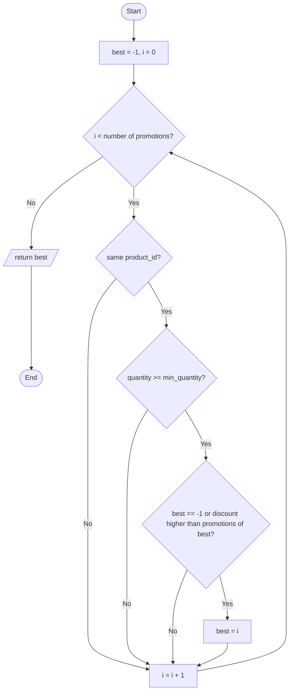

# bestPromotion and finalPrice (T02)

## What it does

`bestPromotion` looks through the promotion list and returns the index of the promotion we should use for one product and one quantity. If no promotion can be used, it returns -1.

Rules from the project brief (section 4):
- A promotion only applies when quantity >= min_quantity.
- If several promotions qualify, take the one with the highest discount_percent.

`finalPrice` then computes the price for that cart line:

final price = price * quantity * (100 - discount_percent) / 100

Everything is `long long`. If bestPromotion returns -1, the discount is 0.

## Pseudocode

```
bestPromotion(promotions, product_id, quantity):
    best = -1
    for i = 0 to size of promotions - 1:
        if promotions[i].product_id == product_id
           and quantity >= promotions[i].min_quantity:
            if best == -1 or promotions[i].discount_percent > promotions[best].discount_percent:
                best = i
    return best

finalPrice(price, quantity, discount_percent):
    return price * quantity * (100 - discount_percent) / 100
```

## Flowchart



## Examples

From the sample session in the brief:
- P001, price 3,590,000, quantity 3, promotion PR001 (10%) -> 9,693,000 VND
- P005, quantity 2, promotion PR003 (5%) -> 3,610,000 VND

For TC02 (P001 in data/full has 10% from 1 pair and 25% from 3 pairs):
- quantity 1 -> only the 10% promotion qualifies, so 10% is used
- quantity 2 -> still only 10%
- quantity 3 -> both qualify, the 25% one is higher, so 25% is used
